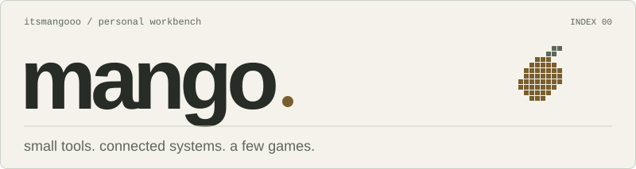
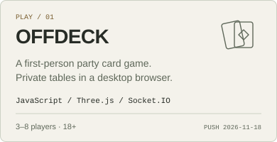
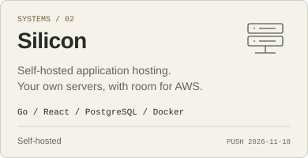
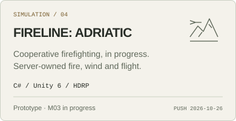
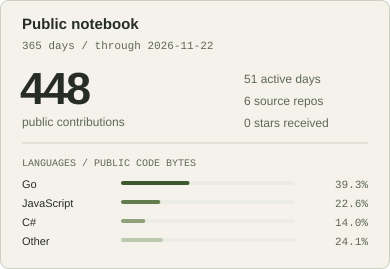
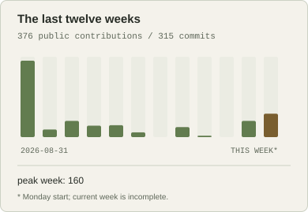
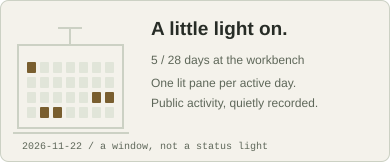

<picture><source media="(prefers-color-scheme: dark)" srcset="assets/header-dark.svg"><source media="(prefers-color-scheme: light)" srcset="assets/header-light.svg"></picture>

I’m mango. I build things I want to use: tools for a homelab, places to deploy them, and games to share with friends.

Most of that lands somewhere between Go services, browser interfaces, Android, and simulation. I like seeing how the pieces fit together.

<picture><source media="(prefers-color-scheme: dark)" srcset="assets/badge-go-dark.svg"><source media="(prefers-color-scheme: light)" srcset="assets/badge-go-light.svg"></picture> <picture><source media="(prefers-color-scheme: dark)" srcset="assets/badge-javascript-dark.svg"><source media="(prefers-color-scheme: light)" srcset="assets/badge-javascript-light.svg"></picture> <picture><source media="(prefers-color-scheme: dark)" srcset="assets/badge-csharp-dark.svg"><source media="(prefers-color-scheme: light)" srcset="assets/badge-csharp-light.svg"></picture> <picture><source media="(prefers-color-scheme: dark)" srcset="assets/badge-dart-dark.svg"><source media="(prefers-color-scheme: light)" srcset="assets/badge-dart-light.svg"></picture>

**Systems** · Go, PostgreSQL, Docker **Interfaces** · JavaScript, React, Flutter **Games** · Three.js, Socket.IO, Unity / C#

### On the workbench

<a href="https://github.com/itsmangooo/offdeck"><picture><source media="(prefers-color-scheme: dark)" srcset="assets/offdeck-dark.svg"><source media="(prefers-color-scheme: light)" srcset="assets/offdeck-light.svg"></picture></a> <a href="https://github.com/itsmangooo/Silicon"><picture><source media="(prefers-color-scheme: dark)" srcset="assets/silicon-dark.svg"><source media="(prefers-color-scheme: light)" srcset="assets/silicon-light.svg"></picture></a> <a href="https://github.com/itsmangooo/Flare"><picture><source media="(prefers-color-scheme: dark)" srcset="assets/flare-dark.svg"><source media="(prefers-color-scheme: light)" srcset="assets/flare-light.svg"></picture></a> <a href="https://github.com/itsmangooo/FIRELINE-ADRIATIC"><picture><source media="(prefers-color-scheme: dark)" srcset="assets/fireline-adriatic-dark.svg"><source media="(prefers-color-scheme: light)" srcset="assets/fireline-adriatic-light.svg"></picture></a>

[Silicon’s public documentation](https://itsmangooo.github.io/Silicon-Docs/) lives on its own shelf. FIRELINE is an ongoing prototype; its repository tracks the open milestones.

### Leaving a trace

<picture><source media="(max-width: 600px) and (prefers-color-scheme: dark)" srcset="assets/calendar-mobile-dark.svg"><source media="(max-width: 600px) and (prefers-color-scheme: light)" srcset="assets/calendar-mobile-light.svg"><source media="(prefers-color-scheme: dark)" srcset="assets/calendar-dark.svg"><source media="(prefers-color-scheme: light)" srcset="assets/calendar-light.svg"></picture>

<picture><source media="(prefers-color-scheme: dark)" srcset="assets/stats-dark.svg"><source media="(prefers-color-scheme: light)" srcset="assets/stats-light.svg"></picture> <picture><source media="(prefers-color-scheme: dark)" srcset="assets/activity-dark.svg"><source media="(prefers-color-scheme: light)" srcset="assets/activity-light.svg"></picture>

Public data only · refreshed 22 Nov 2026 · [How these are counted](docs/WIDGETS.md) · [Refresh workflow](https://github.com/itsmangooo/itsmangooo/actions/workflows/refresh.yml)

<picture><source media="(prefers-color-scheme: dark)" srcset="assets/window-dark.svg"><source media="(prefers-color-scheme: light)" srcset="assets/window-light.svg"></picture>

---

[Repositories](https://github.com/itsmangooo?tab=repositories) · [Silicon docs](https://itsmangooo.github.io/Silicon-Docs/) · [Under the hood](docs/WIDGETS.md)

mango / ASCII: 6d 61 6e 67 6f
