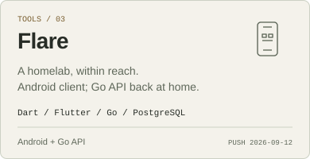
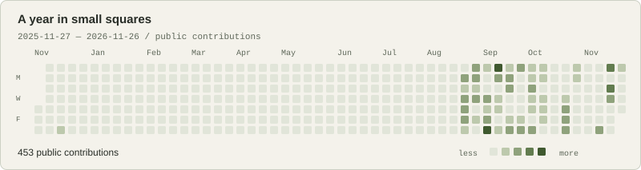
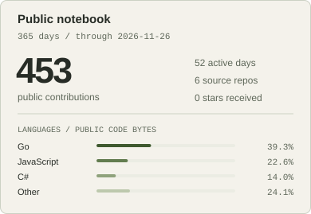
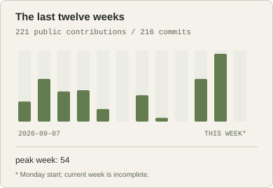
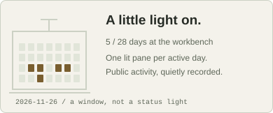

<picture><source media="(prefers-color-scheme: dark)" srcset="assets/header-dark-06d4640cfd05.svg"><source media="(prefers-color-scheme: light)" srcset="assets/header-light-220484fdab67.svg"></picture>

I’m mango. I build things I want to use: tools for a homelab, places to deploy them, and games to share with friends.

Most of that lands somewhere between Go services, browser interfaces, Android, and simulation. I like seeing how the pieces fit together.

<picture><source media="(prefers-color-scheme: dark)" srcset="assets/badge-go-dark-209aaeb24ede.svg"><source media="(prefers-color-scheme: light)" srcset="assets/badge-go-light-4d7bb6400031.svg"></picture> <picture><source media="(prefers-color-scheme: dark)" srcset="assets/badge-javascript-dark-29f584fe56b3.svg"><source media="(prefers-color-scheme: light)" srcset="assets/badge-javascript-light-7f7b554e1262.svg"></picture> <picture><source media="(prefers-color-scheme: dark)" srcset="assets/badge-csharp-dark-7d06ec5b20bd.svg"><source media="(prefers-color-scheme: light)" srcset="assets/badge-csharp-light-dd86324921e4.svg"></picture> <picture><source media="(prefers-color-scheme: dark)" srcset="assets/badge-dart-dark-9341752c276e.svg"><source media="(prefers-color-scheme: light)" srcset="assets/badge-dart-light-15f848918830.svg"></picture>

**Systems** · Go, PostgreSQL, Docker **Interfaces** · JavaScript, React, Flutter **Games** · Three.js, Socket.IO, Unity / C#

### On the workbench

<a href="https://github.com/itsmangooo/offdeck"><picture><source media="(prefers-color-scheme: dark)" srcset="assets/offdeck-dark-e790c07bceae.svg"><source media="(prefers-color-scheme: light)" srcset="assets/offdeck-light-c388277361f2.svg"></picture></a> <a href="https://github.com/itsmangooo/Silicon"><picture><source media="(prefers-color-scheme: dark)" srcset="assets/silicon-dark-9d0327a4e1e7.svg"><source media="(prefers-color-scheme: light)" srcset="assets/silicon-light-b08aa3cc7438.svg"></picture></a> <a href="https://github.com/itsmangooo/Flare"><picture><source media="(prefers-color-scheme: dark)" srcset="assets/flare-dark-0223e605e250.svg"><source media="(prefers-color-scheme: light)" srcset="assets/flare-light-37d3fabcf402.svg"></picture></a> <a href="https://github.com/itsmangooo/FIRELINE-ADRIATIC"><picture><source media="(prefers-color-scheme: dark)" srcset="assets/fireline-adriatic-dark-044434ec0069.svg"><source media="(prefers-color-scheme: light)" srcset="assets/fireline-adriatic-light-7521bb868176.svg"></picture></a>

[Silicon’s public documentation](https://itsmangooo.github.io/Silicon-Docs/) lives on its own shelf. FIRELINE is an ongoing prototype; its repository tracks the open milestones.

### Leaving a trace

<picture><source media="(max-width: 600px) and (prefers-color-scheme: dark)" srcset="assets/calendar-mobile-dark-561bf1f7de4c.svg"><source media="(max-width: 600px) and (prefers-color-scheme: light)" srcset="assets/calendar-mobile-light-ccb7a448464b.svg"><source media="(prefers-color-scheme: dark)" srcset="assets/calendar-dark-bf7889ca5b1d.svg"><source media="(prefers-color-scheme: light)" srcset="assets/calendar-light-b564543a6ab9.svg"></picture>

<picture><source media="(prefers-color-scheme: dark)" srcset="assets/stats-dark-2d01b2763498.svg"><source media="(prefers-color-scheme: light)" srcset="assets/stats-light-c7379f21aafa.svg"></picture> <picture><source media="(prefers-color-scheme: dark)" srcset="assets/activity-dark-6d527d5c2d05.svg"><source media="(prefers-color-scheme: light)" srcset="assets/activity-light-df72f0f535f6.svg"></picture>

Public data only · refreshed 26 Nov 2026 · [How these are counted](docs/WIDGETS.md) · [Refresh workflow](https://github.com/itsmangooo/itsmangooo/actions/workflows/refresh.yml)

<picture><source media="(prefers-color-scheme: dark)" srcset="assets/window-dark-ef163ab68255.svg"><source media="(prefers-color-scheme: light)" srcset="assets/window-light-3cbefe81593a.svg"></picture>

---

[Repositories](https://github.com/itsmangooo?tab=repositories) · [Silicon docs](https://itsmangooo.github.io/Silicon-Docs/) · [Under the hood](docs/WIDGETS.md)

mango / ASCII: 6d 61 6e 67 6f
